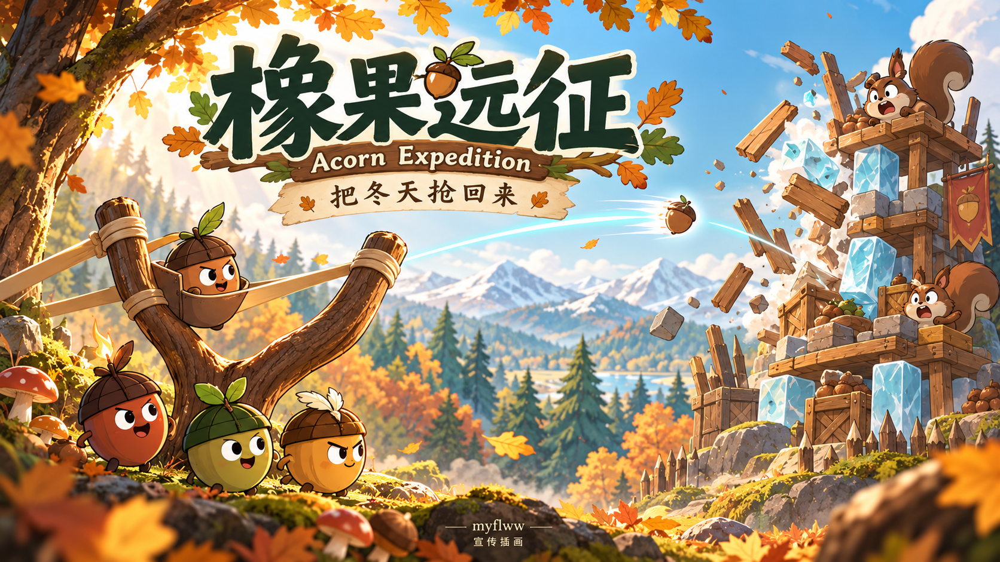
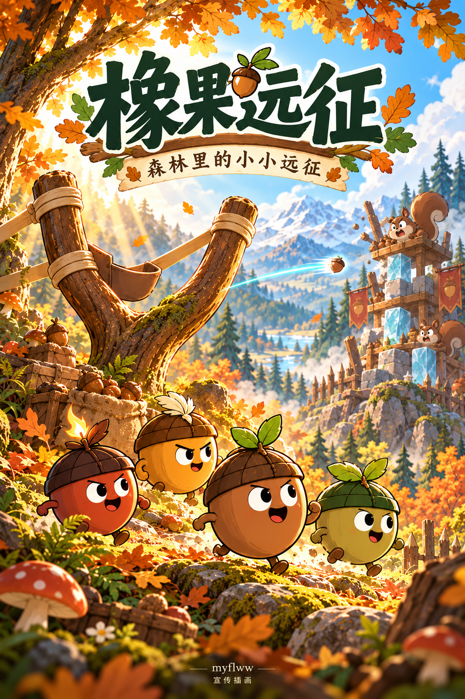
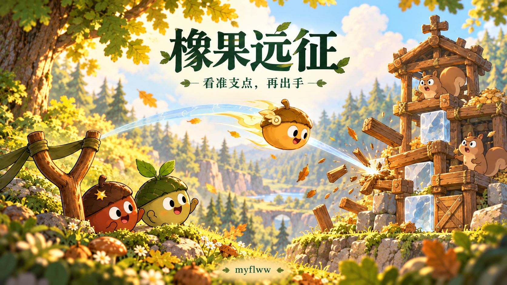
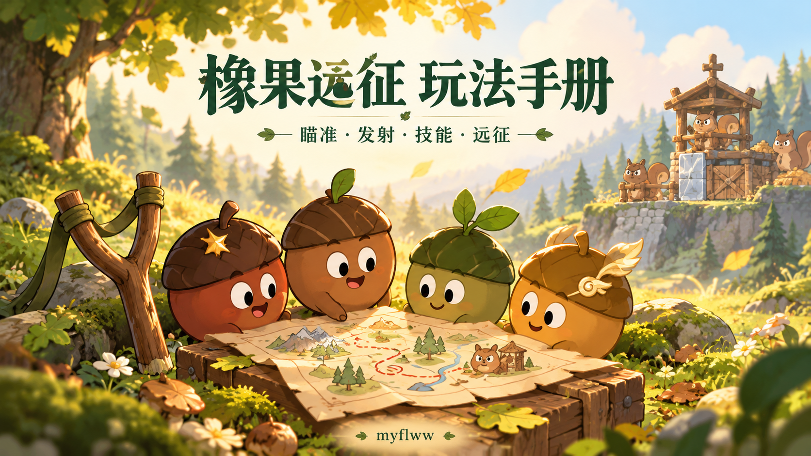

# 橡果远征 · 宣传图与媒体资料

[项目首页](../README.md) · [玩法手册](PLAYING.zh-CN.md) · [署名要求](../ATTRIBUTION.md) · [非商业使用许可](../LICENSE)

《橡果远征 / Acorn Expedition》由 **myflww** 独立制作。拉满树枝弹弓，指挥有不同能力的橡果伙伴，拆解松鼠据点，夺回橡心王国的冬粮。

## 四张宣传插画

图片以本游戏的实机画面和角色设定为参考，由 ImageGen 完整重新绘制，统一为可爱的森林绘本风格。棕色橡宝、红褐爆裂、绿色双叶与金色疾风的配色，以及 Y 形树枝弹弓、木石冰工事和松鼠粮仓都来自游戏主题。

| 图片 | 用途 | 尺寸 |
| --- | --- | --- |
| [横版主海报](../assets/promo/hero-forest.png) | 项目首页、横版分享封面 | 1672 × 941 |
| [竖版远征海报](../assets/promo/portrait-expedition.png) | 竖版分享、作品介绍 | 1024 × 1536 |
| [支点战术图](../assets/promo/tactics-skills.png) | 玩法介绍、攻略配图 | 1672 × 941 |
| [玩法手册封面](../assets/promo/guide-cover.png) | 手册、资料索引 | 1672 × 941 |

这些图是**宣传插画**。构图、比例和飞行轨迹经过艺术化处理，不代表真实界面、精确物理模拟或新增玩法。实际操作请看 [玩法手册](PLAYING.zh-CN.md) 与下面的实机截图。

## 实机截图

以下画面从独立浏览器版直接采集，没有用生成图模拟界面：

- [远征营地主菜单](../assets/screenshots/menu.png)
- [第一关实机](../assets/screenshots/main-stage.png)
- [键盘瞄准与预测弹道](../assets/screenshots/aiming.png)
- [任务、星级与风况面板](../assets/screenshots/mission-panel.png)
- [开局天赋选择](../assets/screenshots/talent-choice.png)

截图中的日期、布局与候选对应采集当次的游戏状态；每日挑战和随机天赋不保证每次相同。

## 分享时标明来源

图片、手册与本仓库随附内容同样**仅限非商业使用**，不因放在公开 GitHub 仓库而允许商用。分享时请保留 **myflww**、原项目来源，以及许可证要求的 `Required Notice:` 声明。完整条款见 [LICENSE](../LICENSE)，复制示例见 [ATTRIBUTION.md](../ATTRIBUTION.md)。

可使用的简短介绍：

> 《橡果远征》是 myflww 独立制作的物理弹射冒险游戏。带着橡宝伙伴，观察结构、搭配天赋，穿过森林、夺回王国的冬粮。源码公开，仅限非商业使用。原项目：https://github.com/myflww/acorn-expedition

## English

Acorn Expedition is an independently created physics adventure game by **myflww**. These four promotional illustrations redraw its acorn companions, branch slingshot, squirrel storehouses and wood/stone/ice structures in a cute forest picture-book style. They are illustrations, not screenshots or exact trajectory diagrams. The separate screenshots come directly from the standalone game.

Artwork and documentation are for noncommercial use under the repository's license. Preserve the author, original source and required notices when sharing. Source: **https://github.com/myflww/acorn-expedition**.
