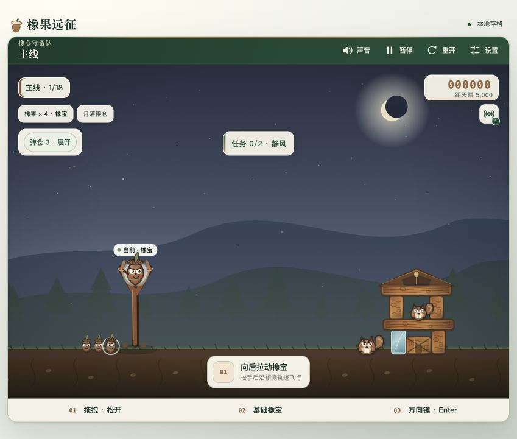
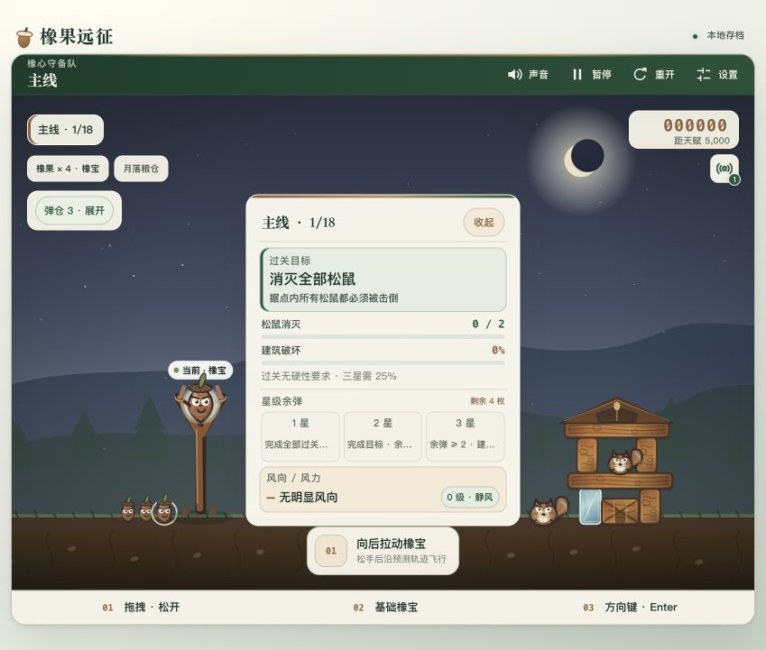
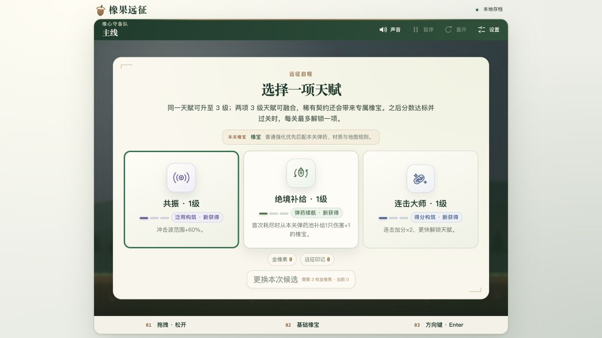

# 橡果远征 · 玩法手册

**拉满树枝弹弓，带着橡宝夺回王国的冬粮。**

作者：[myflww](https://github.com/myflww) · [项目首页](../README.md) · [原项目](https://github.com/myflww/acorn-expedition)

本手册适用于仓库中的独立浏览器版。游戏不需要 Luma、账号或 API 密钥；操作、进度与画面均在本机运行。你将指挥各具能力的橡宝，调整弹道、拆解承重结构，在有限弹药中完成每关任务。

## 1. 五分钟出发

准备 Node.js 20 或更新版本，在 GitHub 选择 **Code → Download ZIP**，解压后进入含 `package.json` 的游戏目录，在终端运行：

```bash
npm run dev
```

浏览器打开 **http://127.0.0.1:4187/**。无需先运行 `npm install`。请保持这个终端开启；游戏结束后可回到终端按 `Ctrl+C` 停止本地服务。不要直接双击 `index.html`，那样可能无法载入游戏，也不会使用相同的存档空间。

1. 在远征营地选择“出发 · 夺回冬粮”，阅读剧情并选择一项开局天赋。
2. 找到左侧树枝弹弓上的橡宝，按住它向后拖。松手后向相反方向发射，拉得越远力量越大。
3. 看右侧松鼠的位置和支柱、横梁的承重关系。先尝试打松下层支点，观察上层如何倒塌。
4. 橡宝飞行时，点击游戏画面或按空格，发动它的主动能力。基础橡宝没有主动技能。
5. 等待本轮碰撞与坍塌结束，再规划下一发。需要复盘时按 `G` 展开“本关战况”。

第一次遇到横风，建议打开“设置 → 弹道模式”，切换到“新手弹道”。它会把风偏计入预测，方便理解弧线与实际落点的关系。



## 2. 操作与画面

| 输入或入口 | 用途 |
| --- | --- |
| 拖拽弹弓上的橡宝，松开 | 瞄准、发射；也可用触屏拖拽 |
| 方向键 | 在橡宝尚未发射时逐步调整拉弓位置 |
| `Enter` | 发射已瞄准的橡宝 |
| 飞行中点击游戏画面 / `Space` | 使用当前橡宝的一次主动能力 |
| `Esc` | 瞄准时取消本次拉弓；否则依当前界面关闭面板、收起任务或打开设置 |
| `P` / 顶部“暂停” | 暂停或继续战斗 |
| `R` / 顶部“重开” | 重开当前关卡；无尽失败后会开始一场新无尽 |
| `G` / 战况卡“任务” | 展开或收起目标、星级条件与风况 |
| 滚轮 | 放大或缩小游戏视角 |
| `M` / 顶部“声音” | 切换声音；也能重新尝试启用被浏览器锁住的声音 |
| 营地按 `D` | 进入每日挑战 |
| 设置中的“全屏显示” | 进入或退出全屏，取决于浏览器支持 |

快捷键在输入框内或有按钮焦点时可能由当前控件处理。键盘操作前可先点击游戏画面。触屏玩家可使用顶部按钮和面板完成设置、暂停与重开。

画面上方显示关卡、分数、弹药、风况与已获天赋；点击天赋图标可查看本次远征的实际效果。“待发序列”能展开查看后续弹药，获得“战术弹仓”后，才可在瞄准前把任意待发橡宝换到发射位。屏幕变窄时先收起辅助面板，给战场留出空间。



## 3. 瞄准、技能与拆城

**先看目标，再看结构，最后决定能力时机。** 多数普通关要击倒全部松鼠；有些关还要求建筑破坏、首领或其他条件。松鼠全倒下却没有结算时，展开战况卡确认剩余要求。

拉弓方向与发射方向相反：向左拉会向右飞；向左下拉通常得到更高的右上抛射。满弓有最大拉距，继续拖远不会无限增加力量。高弧适合越过正面工事，低弧适合直击支柱；风、材质、地形和橡宝本身都会改变结果。

大多数主动能力一发只能用一次，而且要等橡宝已经离弓。不要习惯性地在发射后立刻点技能：爆裂适合靠近目标群，回旋要先飞过目标，钻岩与震地需要先取得高度。技能只控制当前橡宝；双叶分出的幼芽不会各自拥有第二次主动技能。

结构失去一根柱子后仍站着，并不一定是失效。相邻梁柱可能通过钉接、砌缝、树脂或根束继续承重；先切断连接或另一处根基，才能让悬挂部分失去支撑。已经松动的结构也需要时间落稳，急着补下一发会浪费弹药。

首领有更高生命和战斗阶段，**不能靠建材压落直接秒杀**。拆建筑的价值是清理护卫、打通射线和制造进攻窗口，再用适合的高伤害橡宝集中输出。

## 4. 橡宝伙伴与能力时机

主线普通弹药池依次加入五种伙伴；本关实际阵容以“待发序列”为准。后五种为秘境特色伙伴，不能把图鉴中的内容编号当作主线解锁关卡。

| 伙伴 | 能力与使用建议 |
| --- | --- |
| **橡宝** · 主线第 1 关起 | 均衡的棕色橡果，无主动技能。靠直接撞击、反弹与结构连锁完成攻击。 |
| **爆裂橡宝** · 第 2 关起 | 空中引爆，对周围松鼠和建筑造成范围伤害。尽量靠近塔心或密集目标再点。 |
| **双叶橡宝** · 第 4 关起 | 分出上下两枚幼芽橡果，原来的橡宝继续飞行，扩大纵向覆盖。适合多层目标。 |
| **疾风橡宝** · 第 6 关起 | 沿当前速度方向瞬间加速，短时强化撞击。先对准关键支点；强动量可把长梁从命中点断开。 |
| **烈焰橡果** · 第 8 关起 | 空中点燃熔芯，接触建材后附着灼烧，并影响最多两处相邻构件。适合树脂木与承重链，重点是拆结构。 |
| **霜铃橡宝** | 释放霜环，使范围内建材在本场战斗中永久冻结、脆化，并短暂减慢特殊松鼠。先冻塔心，再安排后续重击。 |
| **藤锁橡宝** | 优先抓取关键支点、锚与横梁，绞拉约两秒，移位足够后定点拔榫。只抓一个目标，不能隔着遮挡乱抓；没有合法目标时不消耗技能。 |
| **回旋橡宝** | 反转水平速度并略微抬升，从背面攻击盾牌或内侧支点。飞过目标后再回转，过早发动容易飞回弹弓。 |
| **钻岩橡宝** | 立即放弃水平弹道，垂直高速下钻，基础能力最多穿透四块建材。先飞到石墙或重叠承重链上方。 |
| **震地橡宝** | 收翼俯冲，在落地或撞到建材时释放短程震波。先拉高，给下落留足空间，再对准塔根与支撑链。 |

稀有天赋契约还会提供 **熔心橡宝、镜霜橡宝、雷根橡宝**。熔心需在空中唤醒熔核，命中后附着并连续脉冲；镜霜释放能折射一次的霜环；雷根蓄电后沿承重路径追索最多五处连接点。它们每关额外加入一枚，不计余弹星级和余弹加分。

## 5. 材质、敌人与风

| 看到的材料或机关 | 如何判断 |
| --- | --- |
| 木、石、冰 | 普通木材较轻，石材耐久高、重而稳定，冰材脆滑。基础耐久分别为 3、8、2；强化材料和护板会改变实际耐久。 |
| 叶铁钉接、根灰砌合 | 会把相邻构件连成承重链。先撕开接缝或破坏连接的一端，别只盯着下方空洞。 |
| 树脂木、根土夯砖 | 滴胶与绿色根束会维持连接。烈焰、破甲与集中重击更适合开口。 |
| 风帆布、松脂晶板 | 前者轻薄且易受风，后者更稳且反弹强。晶板可以用于绕击，并非普通冰块。 |
| 叶铁护板 | 外层护甲会先吸收伤害；先剥甲，再追加本体攻击。 |
| 飞鼠搬运挡板 | 实体木板会挡弹道；拆板或击落任一侧搬运飞鼠，可使挡板失去升力。 |

特殊松鼠也要区别处理：盾牌型正面减伤，适合绕后；控风型会干扰弹道；工程型持续修复结构；潜地型要抓住暴露窗口；滑翔型在空中移动，需要预判。第一次发现新对象时会出现图鉴卡，之后可到“远征档案”重读能力与故事。

设置中的三种弹道模式分别是：**“有弹道”显示忽略横风的基准弧线；“新手弹道”计入当前风况；“无弹道”隐藏提示。** 风迹推演天赋的金色风偏标记是额外信息，不会替你切换蓝色弹道模式。秘境的风向、潮位、摆动平台和上升气流可能随发射或时间改变，每发之前都值得再看一眼战况卡。

## 6. 天赋升级与构筑

每场远征先选一项开局天赋，之后累计分数达到里程碑并成功过关时，**每关最多领取一项新选择**。最初几个门槛是 5,000、12,000、22,000、35,000 分；超额分数保留。候选会参考本关弹药、材质和地图，不能保证每场都抽到同一套。

同一天赋最高 **3 级**。下面列出一级的核心作用；二、三级强化请以候选卡与天赋面板为准。



| 天赋 | 一级效果 |
| --- | --- |
| 轻羽 | 重力降低 20%，弹道更飘。 |
| 巨力 | 直接撞击伤害 +1。 |
| 备战 | 每关额外一枚橡宝；无尽满仓时溢出的一枚改为强化一枚基础弹直击。 |
| 烈焰尾迹 | 航迹首次擦过建材造成 1 点伤害，木材再受 1 点灼烧。 |
| 极寒体质 | 霜环范围 +35%，脆化倍率再提高 25%。 |
| 能量回收 | 击倒松鼠时有 35% 概率返还橡果。 |
| 共振 | 冲击波范围 +60%。 |
| 幸运星 | 金橡果出现率乘 3。 |
| 连击大师 | 连击加分乘 2。 |
| 破甲尖锥 | 对石材直伤 +1，并向附近最多两块石材扩散裂纹伤害。 |
| 爆破核心 | 爆裂橡宝的爆炸半径 +25%。 |
| 定风羽 | 风对橡宝的影响降低 50%。 |
| 绝境补给 | 每关首次耗尽时补给一枚直伤 +1 的本关弹药池橡宝。 |
| 战术弹仓 | 解锁待发序列换位；后续等级还会强化换位后的下一发。 |
| 风迹推演 | 显示金色风偏落点与风廊趋势。 |

两项适配天赋都升至三级后，可能出现融合候选，保留双方三级效果并增加联动。例如“巨力 + 破甲尖锥”形成 **破城王冠**，“爆破核心 + 烈焰尾迹”形成 **日铸爆心**，“极寒体质 + 共振”形成 **冻雷共鸣**，“战术弹仓 + 风迹推演”形成 **风算弹仓**。每项基础天赋只能参与一次融合，不会无限叠套。

**燃冠契约、冰镜契约、雷根契约** 的候选还有累计天赋等级与弹药条件，达到条件也不代表立即必出。选天赋时可花 3 枚金橡果更换候选；不足 3 枚且持有远征印记时改花 1 枚印记。天赋属于本次远征，开始一场新远征会重新构筑。

## 7. 四种远征与五大秘境

**主线远征：18 关。** 从失窃粮仓，经过风峡、升降林场、霜石关与云杉运输线进入王城。第 6、12、17、18 关有首领战。完成十八关后开放无尽与五大秘境。已通过的节点可从“主线关卡地图”单关演练，用新布局和开局天赋补星，不覆盖已保存的远征检查点。

**秘境篇章：5 章，各 4 关，共 20 关。** 五章在主线通关后可独立选择；建议按界面顺序学习，各章第一关会介绍核心机制。

| 秘境 | 专属伙伴与核心观察点 |
| --- | --- |
| 极夜钟楼 | 霜铃；冰结接缝、钟面变风、摆动平台。 |
| 潮缚下城 | 藤锁；潮位轮换、湿滑表面、浮筏支点。 |
| 镜林迷宫 | 回旋；真假目标、镜面反弹、开合镜门。 |
| 地心根脉 | 钻岩；低顶石层、断层延迟、矿车与坠物。 |
| 雷云航站 | 震地；上升气流、钢索锚点、周期雷击。 |

先区分“过关目标”与“秘境契约”：额外契约记录精准命中、顺序破拆等挑战，是否必须完成以当前任务卡为准。首次完成对应契约可得一枚金橡果；通过关卡不等于自动完成全部契约。

**无尽模式：** 从第一层重新构筑，难度、敌人和工事逐渐增加，每十层遇到首领。失败即结束这一场远征；暂停退出可以保留尚未失败的关卡起点。普通弹仓最多八枚，天赋契约额外橡宝另算。

**每日挑战：** 按设备本地日期生成“晨间巡逻、战术突围、今日决战”三段，同日规则与随机种子保持一致。第二段还需至少 25% 破坏，第三段需击败首领并达到至少 35% 破坏。每日三段首次全部完成可领一枚金橡果，重复挑战用于刷新成绩；日期更换后，旧每日远征不能作为今日检查点继续。

## 8. 星级、金橡果与失败援助

**一星**需完成本关全部过关目标；**二星**还需至少剩一枚计星橡宝；**三星**需至少剩两枚，并达到结构破坏线。普通关通常为至少 25% 破坏；秘境为本关要求再加 8 个百分点，最高 100%；秘境若设有标准分，还须达到该分数。每关任务卡会显示准确条件。

“剩余弹药”与“计星余弹”不同：备战、能量回收、绝境补给、契约和救援带来的额外弹，均不计余弹星级与余弹奖励。成功过关基础奖励 1,000 分，每枚计星余弹加 250 分。先稳定过关，再回地图补星，比盲目追求少发更容易理解关卡。

地图上的金橡果要实际碰到才会收集，基础奖励 5,000 分，并加入营地余额；幸运星高等级会增加拾取得分，同一场远征中同一关的金果货币奖励不会因重试重复领取。成就、每日完成与秘境契约也有奖励。金橡果是游戏内资源，花费时会扣除本地余额。

秘境或无尽在弹药耗尽且本轮结束后，可使用本关一次紧急补给：**1 枚金橡果买 2 枚橡宝，或 5 枚买 6 枚**，类型来自本关弹药池。自动补给天赋会先处理；选择放弃补给或再次耗尽后，本局结束。主线与每日没有这项购买入口。

在能够重试本关的远征中，相同关卡连续失败三次后，可以在失败页领取 **长老援助**，本关追加两枚当前弹药池橡宝；同一关卡援助只领一次。它也不计余弹星。先读失败页的剩余目标、破坏度与建议，再决定重试、领援助或调整构筑。

## 9. 存档、重开与安全退出

进度保存在当前浏览器来源的 `localStorage`，包括战绩、星章、金橡果、图鉴、成就、设置和远征检查点。主线、无尽、每日与五个秘境各自保留槽位，可从营地选择“继续”对应远征。

检查点保存的是 **本关起点与本次构筑**，不会保存某枚橡宝飞到一半的精确状态。重试本关会恢复相同布局和弹药序列；“重开本局”从第一关建立新远征。新开同一模式会替换该模式的进行中进度与天赋，图鉴、金橡果、星章及其他模式记录保留。

离开前打开设置，选择“离开游戏”，确认出现“远征已保存”后再关窗口。返回营地需要短时间内再次点击确认，首次点击会保存本关起点。切到后台或退出全屏也会暂停战斗。

浏览器、配置文件、域名或端口不同会使用不同存档；`localhost` 与 `127.0.0.1` 也不是同一来源。Luma 内置游戏和独立版分别保存，GitHub 下载代码不会自动搬运存档。清除网站数据、使用无痕窗口或“重置本地记录”可能使记录消失；重置会要求再次点击确认，不能当作普通重开使用。

## 10. 常见问题与许可

**画面打不开？** 检查终端服务仍在运行，并使用 `http://127.0.0.1:4187/`。端口占用时按首页说明改端口；改端口后看见空白记录，通常是使用了另一份存档空间。

**技能没有响应？** 确认橡宝已离弓、当前不在暂停或弹窗中，并且这一发还没使用技能。基础橡宝无技能，钻岩需要在空中发动，藤锁需要可见且在范围内的合法目标。

**看着还有橡宝，星级却不增加？** 展开任务卡查看“计星”数量，额外补给不能刷余弹星；三星还要达到破坏线，秘境还需达到本关标准分。首领、护卫或必要目标没完成时，也不能仅凭剩余弹药过关。

**没有声音或镜头太晃？** 点击“声音”解锁浏览器音频，再到设置调整音乐、音效音量。设置可关闭镜头震动、减少动态效果、跳过已读剧情。

**能跨设备同步或云端续玩吗？** 本版没有账号和云存档。若出现“本地记录暂时无法写入”或“本次进度未能保存”，先检查网站存储权限和磁盘空间，不能把该次退出当作已保存成功。

游戏及本手册随仓库采用 **[PolyForm Noncommercial License 1.0.0](../LICENSE)**，仅限非商业用途。分享原作或修改版时，请保留作者 **myflww**、[原项目来源](https://github.com/myflww/acorn-expedition)、许可和 `NOTICE`；详见[署名说明](../ATTRIBUTION.md)。
